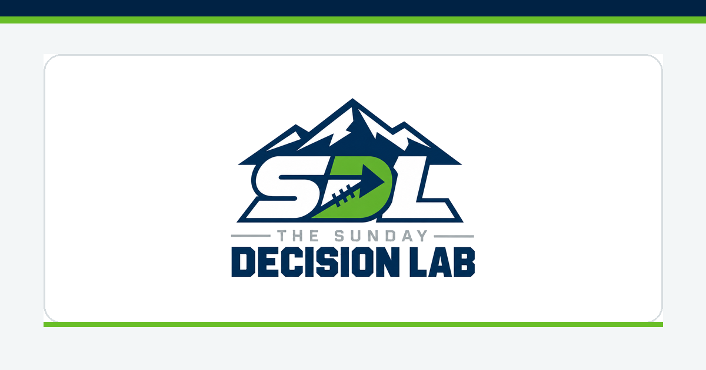
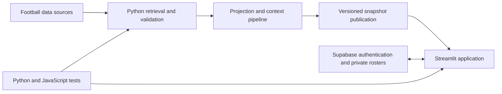

# The Sunday Decision Lab

**A fantasy football decision-support application built by Brecken Galliher.**

SDL brought player research, weekly projections, lineup comparisons, and private roster management into a Python and Streamlit application. The project reached a restricted research pilot with authenticated users, validated data publication, and a tested recovery process.

**Project status: retired from active operation on October 26, 2026.** The source and engineering history are preserved as a portfolio project. Hosting has been suspended and refresh workflows disabled; stored snapshots are historical and must not be used for current lineup decisions.

## Explore the project

- [Tested pilot release source](https://github.com/breckengalliher/fantasy-football-decision-lab/tree/57ccd3051d7147783d5f6b81fdb5964d22833f95)
- [Streamlit application](https://github.com/breckengalliher/fantasy-football-decision-lab/blob/57ccd3051d7147783d5f6b81fdb5964d22833f95/dashboard/app.py) and [projection implementation](https://github.com/breckengalliher/fantasy-football-decision-lab/blob/57ccd3051d7147783d5f6b81fdb5964d22833f95/dashboard/data.py)
- [Release test suite](https://github.com/breckengalliher/fantasy-football-decision-lab/tree/57ccd3051d7147783d5f6b81fdb5964d22833f95/tests)
- [QA evidence summary](docs/portfolio/qa-evidence.json)
- [Original README preserved at retirement](docs/portfolio/original-README.md), including historical setup instructions

The default branch contains earlier development history. The pinned release above identifies the tested pilot runtime; later review branches retain work that was not part of that runtime.

## Product and engineering work

SDL addressed a practical question: **How do my players compare this week, and what evidence should inform my choice?** The application combined scoring-aware player comparisons, recent production and workload, matchup context, written outlooks, and saved team selections. Four-point and six-point passing-touchdown formats were handled separately.

The engineering work extended beyond the comparison screen:

- **Private account and roster handling:** Supabase authentication, row-level access controls, session restoration, and account-isolation checks.
- **Safe editing:** unsaved-draft protection, guarded saves, and snapshot adoption that waits for the user to finish editing.
- **Reliable publication:** provider retrieval and validation separated from the public application; versioned snapshots and last-good recovery prevent partial or failed refreshes from silently replacing trusted data.
- **Honest availability:** incomplete or unverified source information remains restricted or unknown instead of producing a confident actionable recommendation.
- **Release discipline:** candidate-linked regression receipts, separate QA infrastructure, bounded multi-account performance checks, and recovery rehearsals.

## Architecture

The deployed application consumed validated snapshots rather than fetching paid provider data for each visitor. Public analytical data and private account state had separate storage paths. Docker and Render supplied the hosted runtime; GitHub Actions and an isolated scheduler supported refresh and QA publication workflows.

The projection engine used historical and recent production, workload, touchdown regression, bounded matchup adjustments, and separate quarterback scoring formats. Supplemental reporting and availability context had explicit ownership and validation rules. The pinned implementation is the authority for the release; older methodology notes describe earlier iterations.

## Verified QA results

The retained October 15 release qualification for commit `57ccd3051d7147783d5f6b81fdb5964d22833f95` recorded:

| Check | Recorded result | Scope |
| --- | --- | --- |
| Python regression suite | 669 passed, 2 documented fixture skips on both Linux and Windows | The pinned final candidate |
| JavaScript suite | 25 passed | Existing release component tests |
| Multi-account operations | 2,306 successful operations; zero operation errors | Four QA accounts, three 180-second cycles |
| Command Center response | P95 1,109 ms | 20 browser actions during bounded QA load |
| Player comparison response | P95 806 ms | 20 browser actions during bounded QA load |
| Recovery | Compatible runtime restored and checked in QA | No database restore or down-migration |

These are historical engineering measurements, not a claim of indefinite uptime, broad public-launch readiness, or superiority to commercial projections. Model evaluation and operational validation were kept separate. The restricted pilot retained availability limitations.

## Preserved development history

The [onboarding work](https://github.com/breckengalliher/fantasy-football-decision-lab/pull/2) and [safe rollover work](https://github.com/breckengalliher/fantasy-football-decision-lab/pull/3) remain inspectable with their review history. Their final preserved commits are `2c286db` and `421f17b`, respectively. They are not represented as deployed features. Draft, trade, and waiver roadmap ideas are not represented as completed functionality.

The original release evidence remains unchanged in the local project archive. This public case study publishes a narrow summary without private rosters, invitation links, passwords, provider keys, or database backups.

## Running or studying the code

Use the pinned release when investigating the qualified runtime. Its Dockerfile, dependency files, tests, and configuration examples describe that revision. Historical instructions may depend on credentials or snapshots that are no longer active. Review provider terms before obtaining or redistributing data. Existing deployment files are retained as history; do not enable them just to browse the project.

This project is a decision aid and research application, not a guarantee of player outcomes or a betting service.
